# Database Design - Student Digital Competency Profile & Personal Development Roadmap

## 1. Tổng quan

Database sử dụng **PostgreSQL** và được ánh xạ bằng **Prisma ORM**. Thiết kế theo hướng modular, bám sát các nhóm module:

- Auth
- User
- Skill
- Career Goal
- Student Profile
- Recommendation
- Roadmap
- Notification
- Audit & Export

File Prisma chính: `backend/prisma/schema.prisma`.

## 2. ERD

```mermaid
erDiagram
    USERS ||--o| STUDENTS : "has"
    USERS ||--o| LECTURERS : "has"
    USERS ||--o{ NOTIFICATIONS : "receives"
    USERS ||--o{ ACTIVITY_LOGS : "creates"
    USERS ||--o{ EXPORT_LOGS : "creates"

    LECTURERS ||--o{ ADVISOR_ASSIGNMENTS : "advises"
    STUDENTS ||--o{ ADVISOR_ASSIGNMENTS : "assigned"
    SPECIALIZATIONS ||--o{ STUDENTS : "classifies"

    SKILL_CATEGORIES ||--o{ SKILLS : "contains"
    CAREER_GOALS ||--o{ CAREER_REQUIRED_SKILLS : "requires"
    SKILLS ||--o{ CAREER_REQUIRED_SKILLS : "required_in"
    SPECIALIZATIONS ||--o{ CAREER_GOAL_SPECIALIZATIONS : "maps"
    CAREER_GOALS ||--o{ CAREER_GOAL_SPECIALIZATIONS : "maps"

    STUDENTS ||--|| STUDENT_PROFILES : "owns"
    CAREER_GOALS ||--o{ STUDENT_PROFILES : "selected_by"

    STUDENTS ||--o{ STUDENT_SKILLS : "has"
    SKILLS ||--o{ STUDENT_SKILLS : "declared"

    STUDENTS ||--o{ STUDENT_PROJECTS : "owns"
    STUDENTS ||--o{ STUDENT_CERTIFICATES : "owns"
    STUDENTS ||--o{ STUDENT_ACTIVITIES : "owns"
    STUDENTS ||--o{ STUDENT_EXPERIENCES : "owns"
    STUDENTS ||--o{ EVIDENCES : "uploads"

    STUDENTS ||--o{ COMPETENCY_ANALYSIS_RESULTS : "analyzed"
    CAREER_GOALS ||--o{ COMPETENCY_ANALYSIS_RESULTS : "target"
    COMPETENCY_ANALYSIS_RESULTS ||--o{ COMPETENCY_ANALYSIS_DETAILS : "contains"
    SKILLS ||--o{ COMPETENCY_ANALYSIS_DETAILS : "analyzed"

    SKILL_CATEGORIES ||--o{ RECOMMENDATION_TEMPLATES : "scopes"
    SKILLS ||--o{ RECOMMENDATION_TEMPLATES : "has"
    CAREER_GOALS ||--o{ RECOMMENDATION_TEMPLATES : "scopes"
    SPECIALIZATIONS ||--o{ RECOMMENDATION_TEMPLATES : "scopes"
    STUDENTS ||--o{ STUDENT_RECOMMENDATIONS : "receives"
    COMPETENCY_ANALYSIS_RESULTS ||--o{ STUDENT_RECOMMENDATIONS : "generates"
    RECOMMENDATION_TEMPLATES ||--o{ STUDENT_RECOMMENDATIONS : "source"

    STUDENTS ||--o{ DEVELOPMENT_ROADMAPS : "has"
    CAREER_GOALS ||--o{ DEVELOPMENT_ROADMAPS : "target"
    DEVELOPMENT_ROADMAPS ||--o{ ROADMAP_ITEMS : "contains"
    ROADMAP_ITEMS ||--o{ STUDENT_ROADMAP_PROGRESS : "tracked"

    LECTURERS ||--o{ ADVISOR_REVIEWS : "writes"
    STUDENTS ||--o{ ADVISOR_REVIEWS : "receives"

    NOTIFICATIONS ||--o{ NOTIFICATION_LOGS : "sent_as"
```



## 3. Danh sách bảng

### Auth & User

| Bảng | Mục đích |
|---|---|
| `users` | Tài khoản đăng nhập chung |
| `students` | Hồ sơ định danh sinh viên |
| `lecturers` | Hồ sơ định danh giảng viên/cố vấn |
| `advisor_assignments` | Phân công cố vấn cho sinh viên |
| `specializations` | Chuyên ngành/hướng chuyên sâu của sinh viên |

### Skill

| Bảng | Mục đích |
|---|---|
| `skill_categories` | Nhóm kỹ năng |
| `skills` | Danh mục kỹ năng |

### Career Goal

| Bảng | Mục đích |
|---|---|
| `career_goals` | Mục tiêu nghề nghiệp |
| `career_required_skills` | Kỹ năng yêu cầu theo mục tiêu |
| `career_goal_specializations` | Mapping giữa mục tiêu nghề nghiệp và chuyên ngành phù hợp |

### Student Profile

| Bảng | Mục đích |
|---|---|
| `student_profiles` | Hồ sơ năng lực chính |
| `student_skills` | Kỹ năng sinh viên |
| `student_projects` | Dự án sinh viên |
| `student_certificates` | Chứng chỉ sinh viên |
| `student_activities` | Hoạt động ngoại khóa |
| `student_experiences` | Kinh nghiệm làm việc/thực tập |
| `evidences` | Minh chứng |
| `advisor_reviews` | Nhận xét của cố vấn |

### Analysis & Recommendation

| Bảng | Mục đích |
|---|---|
| `competency_analysis_results` | Kết quả phân tích tổng quan |
| `competency_analysis_details` | Chi tiết phân tích từng kỹ năng |
| `recommendation_templates` | Mẫu gợi ý theo chuyên ngành, mục tiêu nghề nghiệp, nhóm kỹ năng hoặc kỹ năng |
| `student_recommendations` | Gợi ý đã sinh cho sinh viên |

### Roadmap

| Bảng | Mục đích |
|---|---|
| `development_roadmaps` | Lộ trình phát triển |
| `roadmap_items` | Nhiệm vụ trong lộ trình |
| `student_roadmap_progress` | Lịch sử/cập nhật tiến độ nhiệm vụ |

### Notification, Audit & Export

| Bảng | Mục đích |
|---|---|
| `notifications` | Thông báo trong hệ thống |
| `notification_logs` | Lịch sử gửi thông báo |
| `activity_logs` | Lịch sử thao tác |
| `export_logs` | Lịch sử xuất file |

## 4. Quan hệ chính

- `users 1-1 students`: một tài khoản sinh viên có một bản ghi student.
- `users 1-1 lecturers`: một tài khoản giảng viên có một bản ghi lecturer.
- `lecturers n-n students`: thông qua `advisor_assignments`.
- `specializations 1-n students`.
- `skill_categories 1-n skills`.
- `career_goals 1-n career_required_skills`.
- `career_goals n-n specializations`: thông qua `career_goal_specializations`.
- `skills 1-n career_required_skills`.
- `students 1-1 student_profiles`.
- `students 1-n student_skills/projects/certificates/activities/experiences/evidences`.
- `students 1-n competency_analysis_results`.
- `competency_analysis_results 1-n competency_analysis_details`.
- `specializations 1-n recommendation_templates`.
- `career_goals 1-n recommendation_templates`.
- `skill_categories 1-n recommendation_templates`.
- `skills 1-n recommendation_templates`.
- `students 1-n student_recommendations`.
- `students 1-n development_roadmaps`.
- `development_roadmaps 1-n roadmap_items`.
- `roadmap_items 1-n student_roadmap_progress`.
- `users 1-n notifications`.

## 5. Unique constraints quan trọng

- `users.email`
- `students.user_id`
- `students.student_code`
- `lecturers.user_id`
- `lecturers.lecturer_code`
- `specializations.name`
- `skill_categories.name`
- `career_goals.name`
- `skills(category_id, name)`
- `advisor_assignments(lecturer_id, student_id)`
- `career_required_skills(career_goal_id, skill_id)`
- `career_goal_specializations(career_goal_id, specialization_id)`
- `recommendation_templates` có thể dùng unique theo phạm vi template nếu cần: `(specialization_id, career_goal_id, skill_category_id, skill_id, recommendation_type, title)`.
- `student_profiles.student_id`
- `student_skills(student_id, skill_id)`
- `competency_analysis_details(analysis_result_id, skill_id)`

## 6. Index tối ưu truy vấn

Các index trong `schema.prisma` ưu tiên cho:

- Phân trang danh sách theo `created_at`.
- Lọc theo trạng thái: `status`, `verification_status`, `evidence_status`.
- Dashboard theo vai trò: `student_id`, `lecturer_id`, `career_goal_id`, `risk_score`, `match_percent`.
- Matching template gợi ý: `specialization_id`, `career_goal_id`, `skill_category_id`, `skill_id`, `priority`.
- Queue xác nhận minh chứng: `evidences(status, created_at)`.
- Lịch sử phân tích: `competency_analysis_results(student_id, analyzed_at)`.
- Lộ trình: `development_roadmaps(student_id, status)`, `roadmap_items(roadmap_id, order_index)`.
- Thông báo chưa đọc: `notifications(user_id, is_read, created_at)`.

## 7. Pagination

Khuyến nghị:

- Dùng cursor pagination cho dữ liệu lớn:
  - `users`
  - `students`
  - `evidences`
  - `activity_logs`
  - `notifications`
  - `competency_analysis_results`
- Dùng offset pagination cho danh mục nhỏ:
  - `skills`
  - `specializations`
  - `skill_categories`
  - `career_goals`
  - `recommendation_templates`

Cursor nên dựa trên:

- `created_at`
- `analyzed_at`
- `updated_at`
- `id` làm tie-breaker khi cần.

## 8. Search

Search cơ bản có thể dùng Prisma:

- `contains`
- `startsWith`
- `mode: 'insensitive'`

Các trường nên hỗ trợ search:

- `users.full_name`, `users.email`
- `students.student_code`, `students.class_name`, `students.major`
- `lecturers.lecturer_code`, `lecturers.department`
- `specializations.name`
- `skills.name`
- `career_goals.name`
- `student_projects.title`
- `student_certificates.certificate_name`

Nếu dữ liệu lớn, nên bổ sung migration SQL riêng cho PostgreSQL:

```sql
CREATE EXTENSION IF NOT EXISTS pg_trgm;

CREATE INDEX users_full_name_trgm_idx
ON users USING gin (full_name gin_trgm_ops);

CREATE INDEX users_email_trgm_idx
ON users USING gin (email gin_trgm_ops);

CREATE INDEX skills_name_trgm_idx
ON skills USING gin (name gin_trgm_ops);

CREATE INDEX students_student_code_trgm_idx
ON students USING gin (student_code gin_trgm_ops);
```

Prisma schema hiện đã khai báo các B-tree index chính. Các GIN/trigram index nên đặt trong migration SQL vì Prisma chưa phải lựa chọn tốt nhất để mô tả mọi index search nâng cao của PostgreSQL.

## 9. Ghi chú thiết kế

- `evidences` dùng quan hệ đa hình qua `related_entity_type` và `related_entity_id` để liên kết với skill, project, certificate, activity, experience hoặc roadmap item.
- `recommendation_templates` dùng các trường scope optional để hỗ trợ fallback từ template cụ thể đến template chung.
- `specializations` giúp recommendation không bị chung chung trên toàn ngành Công nghệ thông tin.
- `current_level` và `required_level` dùng `Int` để phục vụ công thức rule-based trực tiếp.
- Các điểm phần trăm dùng `Decimal(5,2)`.
- Các trọng số và priority score dùng `Decimal(6,2)`.
- Quan hệ ownership dùng `onDelete: Cascade` với dữ liệu thuộc sinh viên.
- Quan hệ danh mục dùng `Restrict` hoặc `SetNull` để tránh mất dữ liệu lịch sử.

## 10. Recommendation template fallback

Khi sinh gợi ý, engine nên tìm template theo thứ tự:

```text
1. specialization_id + career_goal_id + skill_id
2. specialization_id + skill_id
3. career_goal_id + skill_id
4. skill_category_id + skill_id
5. skill_id
6. default generated template
```

Các index nên hỗ trợ:

```text
recommendation_templates(specialization_id, career_goal_id, skill_id, status)
recommendation_templates(career_goal_id, skill_id, status)
recommendation_templates(skill_category_id, skill_id, status)
recommendation_templates(skill_id, status)
recommendation_templates(priority)
```

Thiết kế này cho phép dữ liệu ban đầu nhỏ nhưng vẫn mở rộng được dần theo chuyên ngành, career track hoặc domain cụ thể.
