# Database Design - Student Digital Competency Profile & Personal Development Roadmap

Tài liệu này bám theo `backend/prisma/schema.prisma` hiện tại.

## 1. Tổng quan

Database dùng PostgreSQL và Prisma ORM. Thiết kế chia theo các nhóm dữ liệu:

- Identity & Access.
- Skill Catalog.
- Career Configuration.
- Assessment Question Bank.
- Assessment Runtime.
- Student Profile & Evidence Verification.
- Competency Analysis.
- Recommendation Templates, Learning Resources & Progress.
- Roadmap.
- Notification, Audit & Export Log.

Không có bảng `career_goal_specializations` trong schema hiện tại. Quan hệ chuyên sâu được mô hình hóa bằng `specializations.career_goal_id` và `career_required_skills.specialization_id`.

## 2. ERD tổng quan

```mermaid
erDiagram
    USERS ||--o| STUDENTS : "student account"
    USERS ||--o| LECTURERS : "lecturer account"
    USERS ||--o{ NOTIFICATIONS : "receives"
    USERS ||--o{ NOTIFICATION_LOGS : "logs"
    USERS ||--o{ ACTIVITY_LOGS : "creates"
    USERS ||--o{ EXPORT_LOGS : "creates"

    LECTURERS ||--o{ ADVISOR_ASSIGNMENTS : "advises"
    STUDENTS ||--o{ ADVISOR_ASSIGNMENTS : "assigned"

    SKILL_CATEGORIES ||--o{ SKILLS : "contains"
    SKILL_CATEGORIES ||--o{ RECOMMENDATION_TEMPLATES : "scopes"
    SKILLS ||--o{ CAREER_REQUIRED_SKILLS : "required"
    SKILLS ||--o{ STUDENT_SKILLS : "declared"
    SKILLS ||--o{ ASSESSMENT_QUESTIONS : "tested"
    SKILLS ||--o{ ASSESSMENT_QUESTION_ITEMS : "selected"
    SKILLS ||--o{ ASSESSMENT_SKILL_RESULTS : "graded"
    SKILLS ||--o{ COMPETENCY_ANALYSIS_DETAILS : "analyzed"
    SKILLS ||--o{ RECOMMENDATION_TEMPLATES : "scopes"
    SKILLS ||--o{ STUDENT_RECOMMENDATIONS : "targets"
    SKILLS ||--o{ ROADMAP_ITEMS : "targets"
    SKILLS ||--o{ LEARNING_RESOURCE_SKILLS : "targets"

    ASSESSMENT_QUESTIONS ||--o{ ASSESSMENT_OPTIONS : "has"
    ASSESSMENT_QUESTIONS ||--o{ ASSESSMENT_QUESTION_ITEMS : "used_in"
    ASSESSMENT_QUESTIONS ||--o{ ASSESSMENT_ANSWERS : "answered"
    ASSESSMENT_OPTIONS ||--o{ ASSESSMENT_ANSWERS : "selected"

    CAREER_GOALS ||--o{ SPECIALIZATIONS : "has"
    CAREER_GOALS ||--o{ CAREER_REQUIRED_SKILLS : "requires"
    SPECIALIZATIONS ||--o{ CAREER_REQUIRED_SKILLS : "overrides"
    CAREER_GOALS ||--o{ STUDENT_PROFILES : "selected"
    SPECIALIZATIONS ||--o{ STUDENT_PROFILES : "selected"
    CAREER_GOALS ||--o{ ASSESSMENTS : "target"
    SPECIALIZATIONS ||--o{ ASSESSMENTS : "target"

    STUDENTS ||--|| STUDENT_PROFILES : "owns"
    STUDENTS ||--o{ STUDENT_SKILLS : "has"
    STUDENTS ||--o{ STUDENT_PROJECTS : "owns"
    STUDENTS ||--o{ STUDENT_CERTIFICATES : "owns"
    STUDENTS ||--o{ STUDENT_ACTIVITIES : "owns"
    STUDENTS ||--o{ STUDENT_EXPERIENCES : "owns"
    STUDENTS ||--o{ EVIDENCES : "uploads"
    STUDENTS ||--o{ ASSESSMENTS : "takes"
    STUDENTS ||--o{ COMPETENCY_ANALYSIS_RESULTS : "analyzed"
    STUDENTS ||--o{ STUDENT_RECOMMENDATIONS : "receives"
    STUDENTS ||--o{ STUDENT_RESOURCE_PROGRESS : "tracks"
    STUDENTS ||--o{ DEVELOPMENT_ROADMAPS : "has"
    STUDENTS ||--o{ STUDENT_ROADMAP_PROGRESS : "updates"
    STUDENTS ||--o{ ADVISOR_REVIEWS : "receives"

    ASSESSMENTS ||--o{ ASSESSMENT_QUESTION_ITEMS : "contains"
    ASSESSMENTS ||--o{ ASSESSMENT_ANSWERS : "answers"
    ASSESSMENTS ||--o{ ASSESSMENT_SKILL_RESULTS : "results"

    CAREER_GOALS ||--o{ COMPETENCY_ANALYSIS_RESULTS : "target"
    SPECIALIZATIONS ||--o{ COMPETENCY_ANALYSIS_RESULTS : "target"
    COMPETENCY_ANALYSIS_RESULTS ||--o{ COMPETENCY_ANALYSIS_DETAILS : "contains"
    COMPETENCY_ANALYSIS_RESULTS ||--o{ STUDENT_RECOMMENDATIONS : "generates"

    CAREER_GOALS ||--o{ RECOMMENDATION_TEMPLATES : "scopes"
    SPECIALIZATIONS ||--o{ RECOMMENDATION_TEMPLATES : "scopes"
    RECOMMENDATION_TEMPLATES ||--o{ STUDENT_RECOMMENDATIONS : "source"
    RECOMMENDATION_TEMPLATES ||--o{ RECOMMENDATION_TEMPLATE_RESOURCES : "links"

    LEARNING_RESOURCES ||--o{ LEARNING_RESOURCE_SKILLS : "mapped"
    LEARNING_RESOURCES ||--o{ RECOMMENDATION_TEMPLATE_RESOURCES : "template links"
    LEARNING_RESOURCES ||--o{ STUDENT_RECOMMENDATION_RESOURCES : "snapshots"
    LEARNING_RESOURCES ||--o{ STUDENT_RESOURCE_PROGRESS : "progress"

    STUDENT_RECOMMENDATIONS ||--o{ STUDENT_RECOMMENDATION_RESOURCES : "contains"
    STUDENT_RECOMMENDATIONS ||--o{ STUDENT_RESOURCE_PROGRESS : "context"
    STUDENT_RECOMMENDATIONS ||--o{ ROADMAP_ITEMS : "converted_to"

    CAREER_GOALS ||--o{ DEVELOPMENT_ROADMAPS : "target"
    SPECIALIZATIONS ||--o{ DEVELOPMENT_ROADMAPS : "target"
    DEVELOPMENT_ROADMAPS ||--o{ ROADMAP_ITEMS : "contains"
    DEVELOPMENT_ROADMAPS ||--o{ STUDENT_ROADMAP_PROGRESS : "tracks"
    ROADMAP_ITEMS ||--o{ STUDENT_ROADMAP_PROGRESS : "history"

    LECTURERS ||--o{ ADVISOR_REVIEWS : "writes"
    NOTIFICATIONS ||--o{ NOTIFICATION_LOGS : "sent_as"
```



## 3. Bảng theo module

### Identity & Access

| Bảng | Mục đích |
|---|---|
| `users` | Tài khoản chung, role, status, password hash, refresh token hash |
| `students` | Hồ sơ định danh sinh viên |
| `lecturers` | Hồ sơ định danh giảng viên/cố vấn |
| `advisor_assignments` | Phân công lecturer/student |

### Skill Catalog

| Bảng | Mục đích |
|---|---|
| `skill_categories` | Nhóm kỹ năng; có thể gắn `roadmap_phase` |
| `skills` | Kỹ năng, phân loại `COMMON` hoặc `CAREER_SPECIFIC`, default level/weight |

### Career Configuration

| Bảng | Mục đích |
|---|---|
| `career_goals` | Mục tiêu nghề nghiệp |
| `specializations` | Hướng chuyên sâu thuộc một career goal |
| `career_required_skills` | Kỹ năng yêu cầu theo career goal và optional specialization |

### Assessment Question Bank

| Bảng | Mục đích |
|---|---|
| `assessment_questions` | Câu hỏi theo skill, type, level, status |
| `assessment_options` | Đáp án của câu hỏi, có `is_correct` và `order_index` |

### Assessment Runtime

| Bảng | Mục đích |
|---|---|
| `assessments` | Bài đánh giá của student theo career goal và optional specialization |
| `assessment_question_items` | Snapshot câu hỏi được chọn vào bài |
| `assessment_answers` | Câu trả lời đã chọn và kết quả đúng/sai |
| `assessment_skill_results` | Level tính được theo từng skill sau khi submit |

### Student Profile & Evidence

| Bảng | Mục đích |
|---|---|
| `student_profiles` | Hồ sơ năng lực chính, career goal, specialization, completion, match, risk |
| `student_skills` | Level kỹ năng của sinh viên |
| `student_projects` | Dự án |
| `student_certificates` | Chứng chỉ |
| `student_activities` | Hoạt động |
| `student_experiences` | Kinh nghiệm |
| `evidences` | Minh chứng gắn đa hình vào resource |
| `advisor_reviews` | Nhận xét của cố vấn |

### Analysis, Recommendation, Resource & Progress

| Bảng | Mục đích |
|---|---|
| `competency_analysis_results` | Kết quả phân tích tổng quan, có trạng thái `CURRENT` hoặc `OBSOLETE` |
| `competency_analysis_details` | Chi tiết từng skill |
| `recommendation_templates` | Template gợi ý theo scope optional |
| `student_recommendations` | Gợi ý đã sinh cho sinh viên |
| `learning_resources` | Tài nguyên học tập dùng cho template/recommendation |
| `learning_resource_skills` | Mapping resource với skill/target level/roadmap phase |
| `recommendation_template_resources` | Link resource vào template |
| `student_recommendation_resources` | Snapshot resource được copy vào recommendation |
| `student_resource_progress` | Tiến độ học resource của student |

### Roadmap

| Bảng | Mục đích |
|---|---|
| `development_roadmaps` | Roadmap theo version của student |
| `roadmap_items` | Nhiệm vụ trong roadmap |
| `student_roadmap_progress` | Lịch sử cập nhật trạng thái item |

### Notification, Audit & Export

| Bảng | Mục đích |
|---|---|
| `notifications` | Thông báo in-app |
| `notification_logs` | Log gửi notification qua channel |
| `activity_logs` | Log thao tác |
| `export_logs` | Log xuất file |

## 4. Enum chính

| Enum | Giá trị |
|---|---|
| `UserRole` | `ADMIN`, `LECTURER`, `STUDENT` |
| `UserStatus` | `ACTIVE`, `INACTIVE` |
| `CatalogStatus` | `ACTIVE`, `INACTIVE` |
| `AssignmentStatus` | `ACTIVE`, `INACTIVE` |
| `VerificationStatus` | `NO_EVIDENCE`, `PENDING`, `VERIFIED`, `REJECTED` |
| `EvidenceEntityType` | `SKILL`, `PROJECT`, `CERTIFICATE`, `ACTIVITY`, `EXPERIENCE`, `ROADMAP_ITEM` |
| `EvidenceStatus` | `PENDING`, `VERIFIED`, `REJECTED` |
| `ProjectStatus` | `PLANNED`, `IN_PROGRESS`, `COMPLETED`, `CANCELLED` |
| `MatchLevel` | `NOT_MATCHED`, `DEVELOPING`, `GOOD_MATCH`, `STRONG_MATCH` |
| `SkillLevel` | `ZERO`, `BASIC`, `INTERMEDIATE`, `GOOD` |
| `SkillType` | `COMMON`, `CAREER_SPECIFIC` |
| `QuestionType` | `SINGLE_CHOICE`, `TRUE_FALSE` |
| `QuestionStatus` | `ACTIVE`, `INACTIVE` |
| `AssessmentStatus` | `IN_PROGRESS`, `SUBMITTED`, `GRADED`, `CANCELLED` |
| `AnalysisSkillStatus` | `ACHIEVED`, `MISSING`, `NEED_IMPROVEMENT` |
| `AnalysisResultStatus` | `CURRENT`, `OBSOLETE` |
| `RecommendationType` | `COURSE`, `PROJECT`, `CERTIFICATE`, `PRACTICE`, `DOCUMENT`, `PORTFOLIO_TASK` |
| `LearningResourceType` | `COURSE`, `VIDEO`, `DOCUMENT`, `ARTICLE`, `BOOK`, `PRACTICE`, `PROJECT`, `CERTIFICATE`, `TOOL` |
| `DifficultyLevel` | `BEGINNER`, `INTERMEDIATE`, `ADVANCED` |
| `RoadmapPhase` | `CORE_FOUNDATION`, `CAREER_TRACK`, `SPECIALIZATION`, `PRACTICE_PROJECT`, `PORTFOLIO_PREPARATION` |
| `TemplateStatus` | `ACTIVE`, `INACTIVE` |
| `StudentRecommendationStatus` | `NEW`, `SAVED`, `IN_PROGRESS`, `DONE`, `DISMISSED`, `OBSOLETE` |
| `ResourceProgressStatus` | `NOT_STARTED`, `IN_PROGRESS`, `COMPLETED`, `SKIPPED` |
| `RoadmapStatus` | `ACTIVE`, `ARCHIVED`, `COMPLETED`, `CANCELLED` |
| `RoadmapItemType` | `LEARN`, `PRACTICE`, `PROJECT`, `CERTIFICATE`, `PORTFOLIO` |
| `RoadmapItemStatus` | `TODO`, `IN_PROGRESS`, `DONE`, `CANCELLED` |
| `NotificationType` | `PROFILE_REMINDER`, `EVIDENCE_VERIFIED`, `EVIDENCE_REJECTED`, `ROADMAP_REMINDER`, `ADVISOR_REVIEW`, `WEAK_PROFILE_ALERT`, `SYSTEM` |
| `NotificationChannel` | `IN_APP`, `EMAIL` |
| `NotificationLogStatus` | `PENDING`, `SENT`, `FAILED` |
| `ExportType` | `STUDENT_PORTFOLIO_PDF`, `STUDENTS_EXCEL`, `COMPETENCY_EXCEL`, `LECTURER_STUDENTS_EXCEL` |

## 5. Unique constraints quan trọng

| Constraint | Ý nghĩa |
|---|---|
| `users.email` | Email đăng nhập không trùng |
| `students.user_id`, `lecturers.user_id` | Mỗi user chỉ có một profile role tương ứng |
| `students.student_code`, `lecturers.lecturer_code` | Mã định danh không trùng |
| `advisor_assignments(lecturer_id, student_id)` | Không phân công trùng cùng cặp |
| `skill_categories.name` | Tên nhóm kỹ năng không trùng |
| `skills(category_id, name)` | Tên skill không trùng trong cùng category |
| `career_goals.name` | Tên career goal không trùng |
| `specializations(career_goal_id, name)` | Tên specialization không trùng trong career goal |
| `career_required_skills(career_goal_id, specialization_id, skill_id)` | Một skill không lặp trong cùng scope goal/specialization |
| `student_profiles.student_id` | Mỗi student có một profile chính |
| `student_skills(student_id, skill_id)` | Một skill chỉ xuất hiện một lần trong profile student |
| `assessment_answers(assessment_id, question_id)` | Một câu chỉ có một answer trong bài |
| `assessment_question_items(assessment_id, question_id)` | Một câu chỉ được đưa vào bài một lần |
| `assessment_skill_results(assessment_id, skill_id)` | Một skill có một kết quả trong bài |
| `competency_analysis_details(analysis_result_id, skill_id)` | Một skill có một detail trong một analysis |
| `recommendation_templates(scope fields..., title)` | Template không trùng trong cùng scope/type/phase/level/title |
| `learning_resource_skills(resource_id, skill_id, target_level)` | Resource không link trùng cùng skill/target level |
| `recommendation_template_resources(template_id, resource_id)` | Resource không link trùng vào một template |
| `student_recommendation_resources(recommendation_id, resource_id)` | Snapshot resource không trùng trong một recommendation |
| `student_resource_progress(student_id, resource_id)` | Một student có một progress record cho mỗi resource |
| `development_roadmaps(student_id, version)` | Version roadmap tăng theo student |

Lưu ý: với `specialization_id = null`, service cũng kiểm tra trùng skill ở career-level trước khi create/update required skill.

## 6. Index tối ưu truy vấn

Schema đã khai báo index cho các nhóm truy vấn sau:

- Lọc user theo role/status.
- Lọc student theo class, major, academic year, created time.
- Lọc lecturer theo department, created time.
- Lọc assignment theo lecturer/student/status.
- Lọc catalog theo status/name/type/category/roadmap phase.
- Lọc specialization theo career goal/status/name.
- Lọc required skills theo career goal/specialization/learning order/skill/phase.
- Lọc question bank theo skill/status, question type, level, created time.
- Lọc assessment theo student/status/career goal/specialization.
- Lọc profile theo career goal, specialization, completion, match, risk, last updated.
- Lọc profile resources theo student, verification status, status, created time.
- Lọc evidence theo student/status, related entity, reviewer, created time.
- Lọc analysis theo student/analyzed time, career goal/specialization/status/match/risk.
- Lọc recommendation template theo scope, type, phase, status, priority, title.
- Lọc learning resource theo type/status/title/provider.
- Lọc learning resource skill theo resource/skill/target level.
- Lọc student recommendation theo student/status, analysis, skill, phase.
- Lọc student resource progress theo student/resource/recommendation/status.
- Lọc roadmap theo student/status/version, career goal, specialization, created time.
- Lọc roadmap item theo roadmap/status/phase/order/deadline.
- Lọc notification theo user/isRead/type/related entity.
- Lọc activity/export logs theo user, action/type, created time.

## 7. Pagination và search trong code

Backend dùng offset pagination thống nhất qua `PaginationQueryDto`:

```text
page: number = 1
limit: number = 20, max 100
search?: string
sortBy?: string
sortOrder: asc | desc = desc
```

Response phân trang:

```json
{
  "success": true,
  "data": [],
  "meta": {
    "page": 1,
    "limit": 20,
    "total": 0,
    "totalPages": 0,
    "hasNextPage": false,
    "hasPreviousPage": false
  }
}
```

Search hiện dùng Prisma `contains` với `mode: 'insensitive'` ở các service như users, students, lecturers, skills, career goals, specializations, question bank, learning resources, templates, profile resources, evidence, recommendations, notifications và advisor reviews.

## 8. Thiết kế Assessment

Question bank:

- `assessment_questions.skill_id` bắt buộc và dùng `onDelete: Restrict`.
- `question_type` gồm single choice và true/false.
- `level` là số nguyên, API validate tối thiểu 1; UI hiện dùng level 1-3.
- `DELETE /assessment-questions/:id` chuyển status sang `INACTIVE`.
- Khi deactivate câu hỏi, service cancel assessment `IN_PROGRESS` đang chứa câu hỏi đó.
- `assessment_options` bị xóa cascade theo question.

Assessment runtime:

- `assessments` gắn với `student_id`, `career_goal_id` và optional `specialization_id`.
- Start assessment lấy scope từ `student_profiles`.
- Mỗi scope student/career/specialization có tối đa 3 lần hoàn thành (`SUBMITTED` hoặc `GRADED`), cooldown 30 phút và time limit 60 phút.
- `assessment_question_items` lưu các câu đã chọn cho một lần làm bài.
- `assessment_answers` lưu option được chọn và `is_correct`.
- `assessment_skill_results` lưu `calculated_level`, tổng câu, số câu đúng và `level_breakdown` dạng JSON.
- Khi submit, service upsert `student_skills.current_level` chỉ khi level mới cao hơn level hiện có.

## 9. Thiết kế Evidence

`evidences` là quan hệ đa hình:

```text
related_entity_type: SKILL | PROJECT | CERTIFICATE | ACTIVITY | EXPERIENCE | ROADMAP_ITEM
related_entity_id: string
```

Upload evidence yêu cầu có file hoặc `evidenceUrl`. Khi tạo evidence:

- `evidences.status = PENDING`.
- Resource liên quan được tính lại verification status từ evidence hiện có.

Khi verify/reject:

- Evidence cập nhật `VERIFIED` hoặc `REJECTED`.
- Resource liên quan cập nhật `verificationStatus` hoặc `evidenceStatus`.
- Với `StudentSkill`, nếu verified thì lưu thêm `verifiedById`, `verifiedAt`; reviewer có thể gửi `currentLevel`.

## 10. Thiết kế Analysis, Recommendation và Roadmap

Analysis lấy required skills theo career goal và optional specialization:

- Nếu có specialization, lấy cả required skill cấp career goal và cấp specialization.
- Khi trùng skill, specialization-level override career-level.
- Chỉ xét required skill có skill active.

Công thức chính:

```text
skillScore = min(currentLevel / requiredLevel, 1) * weight
gap = max(requiredLevel - currentLevel, 0)
priorityScore = gap * weight
matchPercent = totalSkillScore / totalWeight * 100
```

Completion percent:

- Basic profile (`studentCode` + `major`): 10.
- Career goal: 15.
- Có skill: 20.
- Có project: 20.
- Có certificate: 10.
- Có activity hoặc experience: 10.
- Evidence trong scope: tối đa 15, với `VERIFIED = 1`, `PENDING = 0.3`, `REJECTED = 0`.

`riskScore` hiện cộng:

- `+25` nếu completion `< 50`.
- `+25` nếu match `< 40`.
- `+20` nếu mọi skill hiện tại đều `<= 0`.
- Giới hạn tối đa 100.

Analysis result có trạng thái:

- `CURRENT`: kết quả đang đại diện cho context hiện tại.
- `OBSOLETE`: kết quả cũ khi chạy analysis mới hoặc khi catalog/context thay đổi.

Recommendation template fallback trong code:

```text
1. specialization_id + career_goal_id + skill_id
2. career_goal_id + skill_id
3. skill_category_id + skill_id
4. skill_id
5. default generated recommendation
```

Template active có resource link sẽ được copy sang snapshot `student_recommendation_resources` khi tạo student recommendation. Snapshot giúp recommendation giữ metadata resource tại thời điểm sinh, kể cả khi resource/template thay đổi sau đó.

Student recommendation status transition:

```text
NEW -> SAVED | DISMISSED
SAVED -> IN_PROGRESS | DISMISSED
IN_PROGRESS -> SAVED | DONE
DONE, DISMISSED, OBSOLETE -> không đổi
```

Learning resource progress transition:

```text
NOT_STARTED -> IN_PROGRESS | SKIPPED
IN_PROGRESS -> COMPLETED | SKIPPED
SKIPPED -> IN_PROGRESS
COMPLETED -> không đổi
```

Nếu toàn bộ resource của recommendation đã `COMPLETED`, service chuyển recommendation sang `DONE` và tự complete các roadmap item active tương ứng.

Roadmap sinh từ latest analysis result `CURRENT` và student recommendations thuộc analysis đó. Item được sắp xếp theo `RoadmapPhase`, `learningOrder`, `priorityScore`, template priority và tên skill. Progress tính theo trọng số item `DONE` trên tổng trọng số item không bị `CANCELLED`.

Roadmap item status transition:

```text
TODO -> IN_PROGRESS | CANCELLED
IN_PROGRESS -> TODO | DONE | CANCELLED
DONE -> IN_PROGRESS, bắt buộc có note
CANCELLED -> không đổi
```

## 11. Catalog invalidation

`CatalogContextInvalidationService` đảm bảo dữ liệu sinh ra từ catalog cũ không tiếp tục được xem là hiện hành.

Khi career context hoặc required skill thay đổi, service:

- Chuyển analysis `CURRENT` trong scope sang `OBSOLETE`.
- Chuyển recommendation actionable (`NEW`, `SAVED`, `IN_PROGRESS`, `DONE`) sang `OBSOLETE`.
- Archive roadmap `ACTIVE`.
- Cancel assessment `IN_PROGRESS`.
- Reset `student_profiles.match_percent`, `risk_score`, `last_analyzed_at`.

Khi skill catalog thay đổi, service tìm các career/specialization scope dùng skill đó rồi invalidate từng scope.

## 12. Notification, Audit và Export

Notification:

- `notifications` lưu thông báo in-app.
- `notification_logs` lưu log gửi theo channel (`IN_APP`, `EMAIL`).
- Scheduler xử lý theo batch size 100 và dùng dedup window để tránh spam.

Activity log:

- `activity_logs` lưu `user_id`, `action`, `entity_type`, `entity_id`, `description`, `created_at`.
- `ActivityLogsService.record` nuốt lỗi ghi log và chỉ warn, không làm fail request chính.
- Hiện chưa có controller đọc activity logs.

Export log:

- `export_logs` lưu `user_id`, `export_type`, `file_url`, `created_at`.
- `ExportLogsService` đã có nhưng hiện chưa có API export PDF/Excel hoàn chỉnh.

## 13. Ghi chú triển khai

- Không nên tài liệu hóa `career_goal_specializations` vì bảng này không tồn tại trong schema hiện tại.
- Frontend type hiện có một số giá trị legacy không có trong Prisma enum, ví dụ `VERIFIED_WITH_PENDING_CHANGES`; backend schema trong tài liệu này là source of truth.
- Một số bảng đã có schema/API nhưng UI còn placeholder, đặc biệt user/student/lecturer management, advisor assignments, advisor reviews và reports.
