# Database Design - Student Digital Competency Profile & Personal Development Roadmap

Tài liệu này bám theo `backend/prisma/schema.prisma` hiện tại.

## 1. Tổng quan

Database dùng PostgreSQL và Prisma ORM. Thiết kế chia theo các nhóm dữ liệu:

- Identity & Access.
- Skill Catalog.
- Assessment Question Bank.
- Assessment.
- Career Configuration.
- Student Profile.
- Evidence Verification.
- Competency Analysis.
- Recommendation & Roadmap.
- Notification, Audit & Export Log.

Không có bảng `career_goal_specializations` trong schema hiện tại. Quan hệ chuyên sâu được mô hình hóa bằng `specializations.career_goal_id` và `career_required_skills.specialization_id`.

## 2. ERD tổng quan

```mermaid
erDiagram
    USERS ||--o| STUDENTS : "student account"
    USERS ||--o| LECTURERS : "lecturer account"
    USERS ||--o{ NOTIFICATIONS : "receives"
    USERS ||--o{ NOTIFICATION_LOGS : "logs"
    USERS ||--o{ ACTIVITY_LOGS : "creates"
    USERS ||--o{ EXPORT_LOGS : "creates"

    LECTURERS ||--o{ ADVISOR_ASSIGNMENTS : "advises"
    STUDENTS ||--o{ ADVISOR_ASSIGNMENTS : "assigned"

    SKILL_CATEGORIES ||--o{ SKILLS : "contains"
    SKILL_CATEGORIES ||--o{ RECOMMENDATION_TEMPLATES : "scopes"
    SKILLS ||--o{ CAREER_REQUIRED_SKILLS : "required"
    SKILLS ||--o{ STUDENT_SKILLS : "declared"
    SKILLS ||--o{ ASSESSMENT_QUESTIONS : "tested"
    SKILLS ||--o{ ASSESSMENT_QUESTION_ITEMS : "selected"
    SKILLS ||--o{ ASSESSMENT_SKILL_RESULTS : "graded"
    SKILLS ||--o{ COMPETENCY_ANALYSIS_DETAILS : "analyzed"
    SKILLS ||--o{ RECOMMENDATION_TEMPLATES : "scopes"
    SKILLS ||--o{ STUDENT_RECOMMENDATIONS : "targets"
    SKILLS ||--o{ ROADMAP_ITEMS : "targets"

    ASSESSMENT_QUESTIONS ||--o{ ASSESSMENT_OPTIONS : "has"
    ASSESSMENT_QUESTIONS ||--o{ ASSESSMENT_QUESTION_ITEMS : "used_in"
    ASSESSMENT_QUESTIONS ||--o{ ASSESSMENT_ANSWERS : "answered"
    ASSESSMENT_OPTIONS ||--o{ ASSESSMENT_ANSWERS : "selected"

    CAREER_GOALS ||--o{ SPECIALIZATIONS : "has"
    CAREER_GOALS ||--o{ CAREER_REQUIRED_SKILLS : "requires"
    SPECIALIZATIONS ||--o{ CAREER_REQUIRED_SKILLS : "overrides"
    CAREER_GOALS ||--o{ STUDENT_PROFILES : "selected"
    SPECIALIZATIONS ||--o{ STUDENT_PROFILES : "selected"
    CAREER_GOALS ||--o{ ASSESSMENTS : "target"

    STUDENTS ||--|| STUDENT_PROFILES : "owns"
    STUDENTS ||--o{ STUDENT_SKILLS : "has"
    STUDENTS ||--o{ STUDENT_PROJECTS : "owns"
    STUDENTS ||--o{ STUDENT_CERTIFICATES : "owns"
    STUDENTS ||--o{ STUDENT_ACTIVITIES : "owns"
    STUDENTS ||--o{ STUDENT_EXPERIENCES : "owns"
    STUDENTS ||--o{ EVIDENCES : "uploads"
    STUDENTS ||--o{ ASSESSMENTS : "takes"
    STUDENTS ||--o{ COMPETENCY_ANALYSIS_RESULTS : "analyzed"
    STUDENTS ||--o{ STUDENT_RECOMMENDATIONS : "receives"
    STUDENTS ||--o{ DEVELOPMENT_ROADMAPS : "has"
    STUDENTS ||--o{ STUDENT_ROADMAP_PROGRESS : "updates"
    STUDENTS ||--o{ ADVISOR_REVIEWS : "receives"

    ASSESSMENTS ||--o{ ASSESSMENT_QUESTION_ITEMS : "contains"
    ASSESSMENTS ||--o{ ASSESSMENT_ANSWERS : "answers"
    ASSESSMENTS ||--o{ ASSESSMENT_SKILL_RESULTS : "results"

    CAREER_GOALS ||--o{ COMPETENCY_ANALYSIS_RESULTS : "target"
    SPECIALIZATIONS ||--o{ COMPETENCY_ANALYSIS_RESULTS : "target"
    COMPETENCY_ANALYSIS_RESULTS ||--o{ COMPETENCY_ANALYSIS_DETAILS : "contains"
    COMPETENCY_ANALYSIS_RESULTS ||--o{ STUDENT_RECOMMENDATIONS : "generates"

    CAREER_GOALS ||--o{ RECOMMENDATION_TEMPLATES : "scopes"
    SPECIALIZATIONS ||--o{ RECOMMENDATION_TEMPLATES : "scopes"
    RECOMMENDATION_TEMPLATES ||--o{ STUDENT_RECOMMENDATIONS : "source"

    CAREER_GOALS ||--o{ DEVELOPMENT_ROADMAPS : "target"
    SPECIALIZATIONS ||--o{ DEVELOPMENT_ROADMAPS : "target"
    DEVELOPMENT_ROADMAPS ||--o{ ROADMAP_ITEMS : "contains"
    DEVELOPMENT_ROADMAPS ||--o{ STUDENT_ROADMAP_PROGRESS : "tracks"
    ROADMAP_ITEMS ||--o{ STUDENT_ROADMAP_PROGRESS : "history"
    STUDENT_RECOMMENDATIONS ||--o{ ROADMAP_ITEMS : "converted_to"

    LECTURERS ||--o{ ADVISOR_REVIEWS : "writes"
    NOTIFICATIONS ||--o{ NOTIFICATION_LOGS : "sent_as"
```



## 3. Bảng theo module

### Identity & Access

| Bảng | Mục đích |
|---|---|
| `users` | Tài khoản chung, role, password hash, refresh token hash |
| `students` | Hồ sơ định danh sinh viên |
| `lecturers` | Hồ sơ định danh giảng viên/cố vấn |
| `advisor_assignments` | Phân công lecturer/student |

### Skill Catalog

| Bảng | Mục đích |
|---|---|
| `skill_categories` | Nhóm kỹ năng; có thể gắn `roadmap_phase` |
| `skills` | Kỹ năng, phân loại `COMMON` hoặc `CAREER_SPECIFIC`, default level/weight |

### Assessment Question Bank

| Bảng | Mục đích |
|---|---|
| `assessment_questions` | Câu hỏi theo skill, type, level, status |
| `assessment_options` | Đáp án của câu hỏi, có `is_correct` và `order_index` |

### Assessment

| Bảng | Mục đích |
|---|---|
| `assessments` | Bài đánh giá của student theo career goal |
| `assessment_question_items` | Snapshot câu hỏi được chọn vào bài |
| `assessment_answers` | Câu trả lời đã chọn và kết quả đúng/sai |
| `assessment_skill_results` | Level tính được theo từng skill sau khi submit |

### Career Configuration

| Bảng | Mục đích |
|---|---|
| `career_goals` | Mục tiêu nghề nghiệp |
| `specializations` | Hướng chuyên sâu thuộc một career goal |
| `career_required_skills` | Kỹ năng yêu cầu theo career goal và optional specialization |

### Student Profile

| Bảng | Mục đích |
|---|---|
| `student_profiles` | Hồ sơ năng lực chính, career goal, completion, match, risk |
| `student_skills` | Level kỹ năng của sinh viên |
| `student_projects` | Dự án |
| `student_certificates` | Chứng chỉ |
| `student_activities` | Hoạt động |
| `student_experiences` | Kinh nghiệm |
| `evidences` | Minh chứng gắn đa hình vào resource |
| `advisor_reviews` | Nhận xét của cố vấn |

### Analysis & Recommendation

| Bảng | Mục đích |
|---|---|
| `competency_analysis_results` | Kết quả phân tích tổng quan |
| `competency_analysis_details` | Chi tiết từng skill |
| `recommendation_templates` | Template gợi ý theo scope optional |
| `student_recommendations` | Gợi ý đã sinh cho sinh viên |

### Roadmap

| Bảng | Mục đích |
|---|---|
| `development_roadmaps` | Roadmap theo version của student |
| `roadmap_items` | Nhiệm vụ trong roadmap |
| `student_roadmap_progress` | Lịch sử cập nhật trạng thái item |

### Notification, Audit & Export

| Bảng | Mục đích |
|---|---|
| `notifications` | Thông báo in-app |
| `notification_logs` | Log gửi notification qua channel |
| `activity_logs` | Log thao tác |
| `export_logs` | Log xuất file |

## 4. Enum chính

| Enum | Giá trị |
|---|---|
| `UserRole` | `ADMIN`, `LECTURER`, `STUDENT` |
| `CatalogStatus` | `ACTIVE`, `INACTIVE` |
| `SkillType` | `COMMON`, `CAREER_SPECIFIC` |
| `QuestionType` | `SINGLE_CHOICE`, `MULTIPLE_CHOICE`, `TRUE_FALSE` |
| `QuestionStatus` | `ACTIVE`, `INACTIVE` |
| `AssessmentStatus` | `IN_PROGRESS`, `SUBMITTED`, `GRADED`, `CANCELLED` |
| `VerificationStatus` | `NO_EVIDENCE`, `PENDING`, `VERIFIED`, `REJECTED` |
| `EvidenceStatus` | `PENDING`, `VERIFIED`, `REJECTED` |
| `MatchLevel` | `NOT_MATCHED`, `DEVELOPING`, `GOOD_MATCH`, `STRONG_MATCH` |
| `AnalysisSkillStatus` | `ACHIEVED`, `MISSING`, `NEED_IMPROVEMENT` |
| `RecommendationType` | `COURSE`, `PROJECT`, `CERTIFICATE`, `PRACTICE`, `DOCUMENT`, `PORTFOLIO_TASK` |
| `RoadmapPhase` | `CORE_FOUNDATION`, `CAREER_TRACK`, `SPECIALIZATION`, `PRACTICE_PROJECT`, `PORTFOLIO_PREPARATION` |
| `RoadmapStatus` | `ACTIVE`, `ARCHIVED`, `COMPLETED`, `CANCELLED` |
| `RoadmapItemStatus` | `TODO`, `IN_PROGRESS`, `DONE`, `CANCELLED` |
| `NotificationType` | `PROFILE_REMINDER`, `EVIDENCE_VERIFIED`, `EVIDENCE_REJECTED`, `ROADMAP_REMINDER`, `ADVISOR_REVIEW`, `WEAK_PROFILE_ALERT`, `SYSTEM` |

## 5. Unique constraints quan trọng

| Constraint | Ý nghĩa |
|---|---|
| `users.email` | Email đăng nhập không trùng |
| `students.user_id`, `lecturers.user_id` | Mỗi user chỉ có một profile role tương ứng |
| `students.student_code`, `lecturers.lecturer_code` | Mã định danh không trùng |
| `advisor_assignments(lecturer_id, student_id)` | Không phân công trùng cùng cặp |
| `skill_categories.name` | Tên nhóm kỹ năng không trùng |
| `skills(category_id, name)` | Tên skill không trùng trong cùng category |
| `career_goals.name` | Tên career goal không trùng |
| `specializations(career_goal_id, name)` | Tên specialization không trùng trong career goal |
| `career_required_skills(career_goal_id, specialization_id, skill_id)` | Một skill không lặp trong cùng scope goal/specialization |
| `student_profiles.student_id` | Mỗi student có một profile chính |
| `student_skills(student_id, skill_id)` | Một skill chỉ xuất hiện một lần trong profile student |
| `assessment_answers(assessment_id, question_id)` | Một câu chỉ có một answer trong bài |
| `assessment_question_items(assessment_id, question_id)` | Một câu chỉ được đưa vào bài một lần |
| `assessment_skill_results(assessment_id, skill_id)` | Một skill có một kết quả trong bài |
| `competency_analysis_details(analysis_result_id, skill_id)` | Một skill có một detail trong một analysis |
| `development_roadmaps(student_id, version)` | Version roadmap tăng theo student |

Lưu ý: với `specialization_id = null`, service `CareerGoalsService` cũng kiểm tra trùng skill ở career-level trước khi create/update required skill.

## 6. Index tối ưu truy vấn

Schema đã khai báo index cho các nhóm truy vấn sau:

- Lọc user theo role.
- Lọc student theo class, major, academic year, created time.
- Lọc lecturer theo department, created time.
- Lọc assignment theo lecturer/student/status.
- Lọc catalog theo status/name/type/category.
- Lọc question bank theo skill/status, question type, level, created time.
- Lọc assessment theo student/status/career goal.
- Lọc profile theo career goal, specialization, completion, match, risk, last updated.
- Lọc profile resources theo student, verification status, status, created time.
- Lọc evidence theo student/status, related entity, reviewer, created time.
- Lọc analysis theo student/analyzed time, career goal/match level, risk, match percent.
- Lọc recommendation template theo scope, type, phase, status, priority.
- Lọc student recommendation theo student/status, analysis, skill, phase.
- Lọc roadmap theo student/status/version, career goal, specialization, created time.
- Lọc roadmap item theo roadmap/status/phase/order/deadline.
- Lọc notification theo user/isRead/type/related entity.
- Lọc activity/export logs theo user, action/type, created time.

## 7. Pagination và search trong code

Backend dùng offset pagination thống nhất qua `PaginationQueryDto`:

```text
page: number = 1
limit: number = 20, max 100
search?: string
sortBy?: string
sortOrder: asc | desc = desc
```

Response phân trang:

```json
{
  "success": true,
  "data": [],
  "meta": {
    "page": 1,
    "limit": 20,
    "total": 0,
    "totalPages": 0,
    "hasNextPage": false,
    "hasPreviousPage": false
  }
}
```

Search hiện dùng Prisma `contains` với `mode: 'insensitive'` ở các service như skills, career goals, question bank, profile resources, evidence, recommendations, notifications.

## 8. Thiết kế Assessment

Question bank:

- `assessment_questions.skill_id` bắt buộc và dùng `onDelete: Restrict`.
- `question_type` gồm single choice, multiple choice, true/false.
- `level` là số nguyên, API validate tối thiểu 1; UI hiện dùng level 1-3.
- `DELETE /assessment-questions/:id` chuyển status sang `INACTIVE`.
- `assessment_options` bị xóa cascade theo question.

Assessment runtime:

- `assessments` gắn với `student_id` và `career_goal_id`.
- `assessment_question_items` lưu các câu đã chọn cho một lần làm bài.
- `assessment_answers` lưu option được chọn và `is_correct`.
- `assessment_skill_results` lưu `calculated_level`, tổng câu, số câu đúng và `level_breakdown` dạng JSON.
- Khi submit, service upsert `student_skills.current_level` theo kết quả tính được.

## 9. Thiết kế Evidence

`evidences` là quan hệ đa hình:

```text
related_entity_type: SKILL | PROJECT | CERTIFICATE | ACTIVITY | EXPERIENCE | ROADMAP_ITEM
related_entity_id: string
```

Upload evidence yêu cầu có file hoặc `evidenceUrl`. Khi tạo evidence:

- `evidences.status = PENDING`.
- Resource liên quan chuyển sang `VerificationStatus.PENDING`.

Khi verify/reject:

- Evidence cập nhật `VERIFIED` hoặc `REJECTED`.
- Resource liên quan cập nhật `verificationStatus` hoặc `evidenceStatus`.
- Với `StudentSkill`, nếu verified thì lưu thêm `verifiedById` và `verifiedAt`.

## 10. Thiết kế Analysis, Recommendation và Roadmap

Analysis lấy required skills theo career goal và optional specialization:

- Nếu có specialization, lấy cả required skill cấp career goal và cấp specialization.
- Khi trùng skill, specialization-level override career-level.

Công thức chính:

```text
skillScore = min(currentLevel / requiredLevel, 1) * weight
gap = max(requiredLevel - currentLevel, 0)
priorityScore = gap * weight
matchPercent = totalSkillScore / totalWeight * 100
```

`riskScore` hiện cộng:

- `+25` nếu completion `< 50`.
- `+25` nếu match `< 40`.
- `+20` nếu mọi skill hiện tại đều `<= 0`.
- Giới hạn tối đa 100.

Recommendation template fallback trong code:

```text
1. specialization_id + career_goal_id + skill_id
2. career_goal_id + skill_id
3. skill_category_id + skill_id
4. skill_id
5. default generated recommendation
```

Roadmap sinh từ latest analysis result và student recommendations thuộc analysis đó. Item được sắp xếp theo `RoadmapPhase`, `learningOrder`, `priorityScore`, template priority và tên skill. Progress tính theo trọng số item `DONE` trên tổng trọng số item không bị `CANCELLED`.

## 11. Ghi chú triển khai

- Schema có `ActivityLog` và `ExportLog`, nhưng code hiện chưa ghi log thao tác/xuất file qua controller.
- Schema có `AdvisorReview`, nhưng code hiện chưa có module/controller review.
- Schema có `Specialization` và `RecommendationTemplate`, nhưng chưa có UI/API CRUD riêng.
- Không nên tài liệu hóa `career_goal_specializations` vì bảng này không tồn tại trong schema hiện tại.
