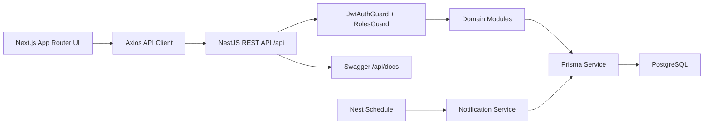
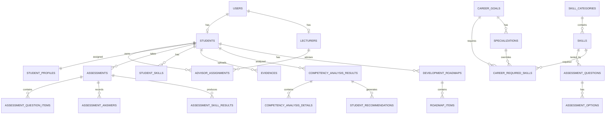
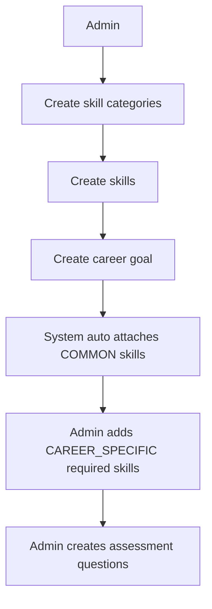
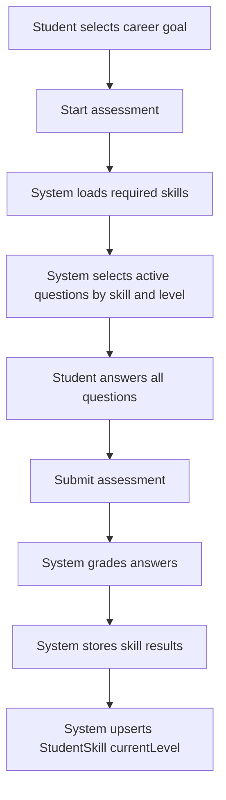
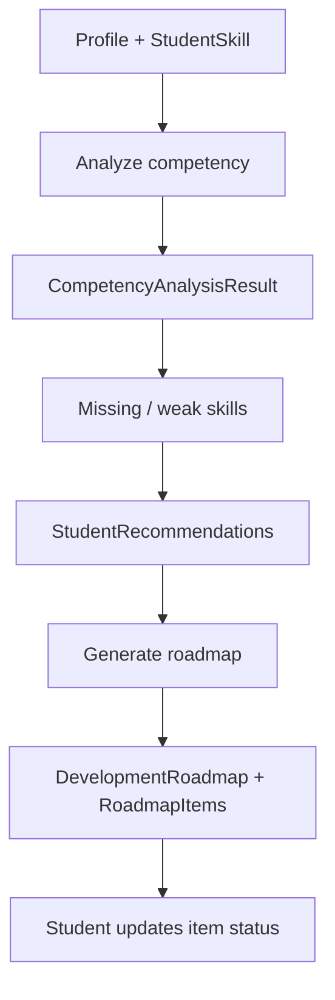
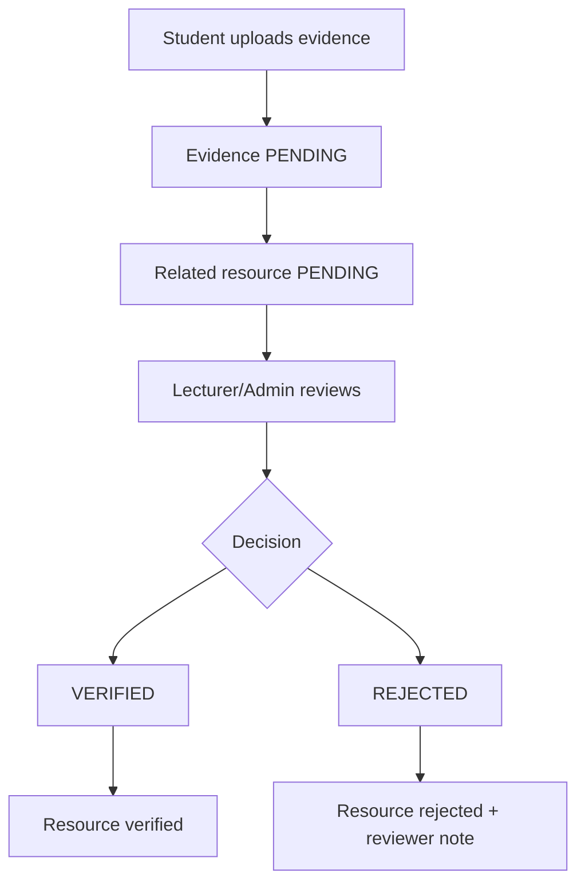

# PHÂN TÍCH VÀ THIẾT KẾ HỆ THỐNG

## Đề tài

**Student Digital Competency Profile & Personal Development Roadmap**

## Thông tin tài liệu

Tài liệu này mô tả thiết kế hệ thống theo code hiện tại. Các phần "chưa triển khai" là những model/placeholder hoặc ý tưởng đã có định hướng nhưng chưa có controller/UI hoàn chỉnh trong repository.

## 1. Giới thiệu

### 1.1. Mục đích

Hệ thống giúp sinh viên:

- Xây dựng hồ sơ năng lực số.
- Làm bài assessment để cập nhật level kỹ năng dựa trên câu hỏi.
- Phân tích khoảng cách giữa năng lực hiện tại và mục tiêu nghề nghiệp.
- Nhận recommendation và roadmap cá nhân.
- Theo dõi tiến độ và minh chứng.

Admin cấu hình dữ liệu nền tảng. Lecturer/cố vấn theo dõi sinh viên được phân công và duyệt minh chứng.

### 1.2. Phạm vi hiện tại

Đã có:

- Auth, JWT, refresh cookie.
- Catalog skill/category.
- Career goal và required skills.
- Assessment question bank.
- Student assessment start/submit.
- Student profile/resources/evidence.
- Evidence review.
- Competency analysis.
- Recommendation generation/status.
- Roadmap generation/progress.
- Notifications và dashboard.

Chưa có API/UI hoàn chỉnh:

- CRUD users/students/lecturers.
- Specializations management.
- Recommendation template management.
- Advisor reviews.
- Export PDF/Excel.
- Activity logs.

## 2. Tác nhân và phân quyền

| Tác nhân | Mô tả |
|---|---|
| Admin | Quản trị dữ liệu nền, dashboard hệ thống, question bank, advisor assignments |
| Lecturer | Cố vấn/giảng viên, xem dữ liệu student được phân công, duyệt evidence |
| Student | Chủ sở hữu hồ sơ năng lực, assessment, analysis, recommendations, roadmap |

Ma trận quyền:

| Chức năng | Admin | Lecturer | Student |
|---|---:|---:|---:|
| Login/logout/refresh | Có | Có | Có |
| Skill categories/skills | CRUD | Không | Frontend cần đọc để chọn skill, nhưng backend hiện khóa theo Admin |
| Career goals/required skills | CRUD | Một số endpoint cho create career goal có role lecturer trong controller | Frontend cần đọc để chọn career goal, nhưng backend hiện khóa theo Admin |
| Assessment question bank | CRUD | Không | Không |
| Start/submit assessment | Không | Không | Có |
| Profile/resources của mình | Không | Không | CRUD |
| Xem profile student khác | Có | Có | Không |
| Upload evidence | Không | Không | Có |
| Duyệt evidence | Có | Có nếu được phân công | Không |
| Analyze current student | Không | Không | Có |
| Analyze selected student | Có | Có nếu được phân công | Không |
| Recommendation status | Không | Không | Có |
| Roadmap của mình | Không | Không | Có |
| Generate roadmap for student | Có | Có nếu được phân công | Không |
| Dashboard | Admin dashboard | Lecturer dashboard | Student dashboard |

## 3. Kiến trúc hệ thống



### 3.1. Frontend

Frontend dùng Next.js App Router, Ant Design và React Query. Route được chia theo role:

- `/admin/*`.
- `/lecturer/*`.
- `/student/*`.

`ProtectedRoute` kiểm tra user hiện tại và redirect về `/login` nếu chưa đăng nhập hoặc sai role.

### 3.2. Backend

Backend dùng NestJS module theo domain. `AppModule` import:

- `AuthModule`.
- `UsersModule`.
- `StudentsModule`.
- `LecturersModule`.
- `AdvisorAssignmentsModule`.
- `SkillCategoriesModule`.
- `SkillsModule`.
- `CareerGoalsModule`.
- `AssessmentQuestionsModule`.
- `AssessmentsModule`.
- `ProfilesModule`.
- `EvidencesModule`.
- `CompetencyAnalysisModule`.
- `RecommendationsModule`.
- `RoadmapsModule`.
- `NotificationsModule`.
- `DashboardModule`.

### 3.3. Chuẩn response

Thành công:

```json
{
  "success": true,
  "data": {}
}
```

Phân trang:

```json
{
  "success": true,
  "data": [],
  "meta": {
    "page": 1,
    "limit": 20,
    "total": 0,
    "totalPages": 0,
    "hasNextPage": false,
    "hasPreviousPage": false
  }
}
```

Lỗi:

```json
{
  "success": false,
  "statusCode": 400,
  "message": "Bad request",
  "path": "/api/...",
  "timestamp": "..."
}
```

## 4. Thiết kế dữ liệu

### 4.1. Nhóm bảng

| Nhóm | Bảng |
|---|---|
| Identity | `users`, `students`, `lecturers`, `advisor_assignments` |
| Skill Catalog | `skill_categories`, `skills` |
| Assessment Question Bank | `assessment_questions`, `assessment_options` |
| Assessment | `assessments`, `assessment_question_items`, `assessment_answers`, `assessment_skill_results` |
| Career Configuration | `career_goals`, `specializations`, `career_required_skills` |
| Student Profile | `student_profiles`, `student_skills`, `student_projects`, `student_certificates`, `student_activities`, `student_experiences`, `evidences`, `advisor_reviews` |
| Analysis | `competency_analysis_results`, `competency_analysis_details` |
| Recommendation | `recommendation_templates`, `student_recommendations` |
| Roadmap | `development_roadmaps`, `roadmap_items`, `student_roadmap_progress` |
| Notification/Audit/Export | `notifications`, `notification_logs`, `activity_logs`, `export_logs` |

### 4.2. ERD rút gọn



## 5. Use case chính

### 5.1. Admin cấu hình dữ liệu nền



### 5.2. Student làm assessment



### 5.3. Student phân tích năng lực và sinh roadmap



### 5.4. Evidence review



## 6. Quy tắc nghiệp vụ quan trọng

### 6.1. Auth

- Password được hash bằng bcrypt.
- Refresh token chỉ lưu hash trong database.
- Change password xóa refresh token hash để revoke session cũ.
- Frontend tự refresh session khi access token hết hạn.

### 6.2. Required skills

- Tạo career goal sẽ tự thêm các skill `COMMON`.
- Required skill thủ công trên UI hiện lấy skill `CAREER_SPECIFIC`.
- `requiredLevel` từ 1 đến 3.
- `weight` tối thiểu 0.01.

### 6.3. Question bank

- `SINGLE_CHOICE`: đúng 1 đáp án.
- `TRUE_FALSE`: đúng 2 đáp án, đúng 1 đáp án đúng.
- `MULTIPLE_CHOICE`: ít nhất 1 đáp án đúng.
- Delete question là deactivate, không xóa vật lý.

### 6.4. Assessment grading

- Student phải trả lời tất cả câu hỏi.
- Không cho duplicate answers.
- Option được chọn phải thuộc question tương ứng.
- Mỗi level phải đạt ngưỡng 60%.
- Level tính được là chuỗi level đạt liên tiếp từ level 1.
- Kết quả assessment cập nhật `student_skills.current_level`.

### 6.5. Analysis

Completion percent hiện tính:

- `+10` nếu student có student code và major.
- `+15` nếu có career goal.
- `+20` nếu có ít nhất một skill.
- `+20` nếu có ít nhất một project.
- `+10` nếu có ít nhất một certificate.
- `+10` nếu có activity hoặc experience.
- `+15` nếu có evidence.

Match percent:

```text
matchPercent = totalSkillScore / totalWeight * 100
```

Risk score:

- `+25` nếu completion `< 50`.
- `+25` nếu match `< 40`.
- `+20` nếu mọi skill hiện tại `<= 0`.

### 6.6. Recommendation

Template fallback trong code:

```text
specialization + career goal + skill
career goal + skill
skill category + skill
skill
default generated
```

Nếu không có template, recommendation default vẫn được tạo để hệ thống không bị dừng.

### 6.7. Roadmap

- Roadmap cần latest analysis.
- Roadmap cần recommendation của latest analysis.
- Roadmap mới archive active roadmap cũ mặc định.
- Progress chỉ tính các item không bị `CANCELLED`.
- Khi progress 100%, roadmap chuyển `COMPLETED`.

## 7. Thiết kế API

### 7.1. Auth/User

| Method | Path | Role | Mục đích |
|---|---|---|---|
| GET | `/api/health` | Public | Health check |
| POST | `/api/auth/login` | Public | Đăng nhập |
| POST | `/api/auth/refresh` | Public + refresh cookie | Refresh token |
| POST | `/api/auth/logout` | Authenticated | Đăng xuất |
| GET | `/api/auth/me` | Authenticated | Profile auth |
| GET | `/api/auth/profile` | Authenticated | Profile auth |
| POST | `/api/auth/change-password` | Authenticated | Đổi mật khẩu |
| GET | `/api/users/me` | Authenticated | User payload hiện tại |
| GET | `/api/users` | Admin | Danh sách user |

### 7.2. Catalog và career configuration

| Method | Path | Role | Mục đích |
|---|---|---|---|
| GET | `/api/skill-categories` | Admin class-level trong controller | Danh sách category |
| POST | `/api/skill-categories` | Admin | Tạo category |
| GET | `/api/skill-categories/:id` | Admin | Chi tiết category |
| PATCH | `/api/skill-categories/:id` | Admin | Cập nhật category |
| DELETE | `/api/skill-categories/:id` | Admin | Xóa category |
| GET | `/api/skills` | Admin class-level trong controller | Danh sách skill |
| POST | `/api/skills` | Admin | Tạo skill |
| GET | `/api/skills/:id` | Admin | Chi tiết skill |
| PATCH | `/api/skills/:id` | Admin | Cập nhật skill |
| DELETE | `/api/skills/:id` | Admin | Xóa skill |
| GET | `/api/career-goals` | Admin class-level trong controller | Danh sách career goal |
| POST | `/api/career-goals` | Admin, Lecturer | Tạo career goal |
| GET | `/api/career-goals/:id` | Admin | Chi tiết career goal |
| PATCH | `/api/career-goals/:id` | Admin | Cập nhật career goal |
| DELETE | `/api/career-goals/:id` | Admin | Xóa career goal |
| GET/POST/PATCH/DELETE | `/api/career-goals/:careerGoalId/required-skills...` | Admin | Required skills |

### 7.3. Assessment

| Method | Path | Role | Mục đích |
|---|---|---|---|
| GET | `/api/assessment-questions` | Admin | Danh sách question bank |
| POST | `/api/assessment-questions` | Admin | Tạo câu hỏi |
| GET | `/api/assessment-questions/:id` | Admin | Chi tiết câu hỏi |
| PATCH | `/api/assessment-questions/:id` | Admin | Cập nhật câu hỏi |
| DELETE | `/api/assessment-questions/:id` | Admin | Deactivate câu hỏi |
| POST | `/api/assessments/start` | Student | Bắt đầu assessment |
| POST | `/api/assessments/:id/submit` | Student | Submit và chấm điểm |

### 7.4. Profile/Evidence

| Method | Path | Role | Mục đích |
|---|---|---|---|
| GET/PATCH | `/api/profiles/me` | Student | Xem/cập nhật profile |
| POST | `/api/profiles/me/avatar` | Student | Upload avatar |
| GET/POST/PATCH/DELETE | `/api/profiles/me/skills` | Student | Kỹ năng của mình |
| GET/POST/PATCH/DELETE | `/api/profiles/me/projects` | Student | Dự án |
| GET/POST/PATCH/DELETE | `/api/profiles/me/certificates` | Student | Chứng chỉ |
| GET/POST/PATCH/DELETE | `/api/profiles/me/activities` | Student | Hoạt động |
| GET/POST/PATCH/DELETE | `/api/profiles/me/experiences` | Student | Kinh nghiệm |
| POST | `/api/profiles/me/{resource}/:id/evidences` | Student | Upload evidence cho resource |
| GET | `/api/profiles/:studentId/...` | Admin, Lecturer | Xem profile/resource student |
| POST | `/api/evidences` | Student | Upload evidence chung |
| GET | `/api/evidences/me` | Student | Evidence của mình |
| GET | `/api/evidences/pending` | Admin, Lecturer | Queue pending |
| GET | `/api/evidences` | Admin | Toàn bộ evidence |
| GET | `/api/evidences/:id` | Student, Lecturer, Admin | Chi tiết evidence |
| PATCH | `/api/evidences/:id/verify` | Admin, Lecturer | Duyệt |
| PATCH | `/api/evidences/:id/reject` | Admin, Lecturer | Từ chối |

### 7.5. Analysis, recommendation, roadmap

| Method | Path | Role | Mục đích |
|---|---|---|---|
| POST | `/api/competency/analyze/me` | Student | Phân tích hồ sơ của mình |
| GET | `/api/competency/analysis-history/me` | Student | Lịch sử analysis |
| GET | `/api/competency/analysis-results/:id` | Student, Lecturer, Admin | Chi tiết analysis |
| POST | `/api/competency/students/:studentId/analyze` | Lecturer, Admin | Phân tích student cụ thể |
| GET | `/api/recommendations/me` | Student | Recommendation của mình |
| PATCH | `/api/recommendations/:id/status` | Student | Cập nhật trạng thái |
| POST | `/api/roadmaps/generate/me` | Student | Sinh roadmap của mình |
| GET | `/api/roadmaps/me` | Student | Active roadmap hoặc null |
| GET | `/api/roadmaps/history/me` | Student | Lịch sử roadmap |
| GET | `/api/roadmaps/:id` | Student, Lecturer, Admin | Chi tiết roadmap |
| PATCH | `/api/roadmap-items/:id/status` | Student | Cập nhật item |
| PATCH | `/api/roadmaps/items/:id/status` | Student | Alias cập nhật item |
| POST | `/api/roadmaps/students/:studentId/generate` | Lecturer, Admin | Sinh roadmap cho student |

### 7.6. Notifications/Dashboard

| Method | Path | Role | Mục đích |
|---|---|---|---|
| GET | `/api/notifications/me` | Authenticated | Notification của mình |
| GET | `/api/notifications/me/unread-count` | Authenticated | Số unread |
| PATCH | `/api/notifications/:id/read` | Authenticated | Mark read |
| PATCH | `/api/notifications/read-all` | Authenticated | Mark all read |
| GET | `/api/dashboard/student` | Student | Dashboard student |
| GET | `/api/dashboard/lecturer` | Lecturer | Dashboard lecturer |
| GET | `/api/dashboard/admin` | Admin | Dashboard admin |

## 8. Thiết kế giao diện

### 8.1. Sitemap hiện tại

```mermaid
flowchart TD
    Login["/login"] --> Admin["/admin"]
    Login --> Lecturer["/lecturer"]
    Login --> Student["/student"]

    Admin --> AD["dashboard"]
    Admin --> AU["users placeholder"]
    Admin --> AS["students placeholder"]
    Admin --> AL["lecturers placeholder"]
    Admin --> ASC["skill-categories"]
    Admin --> ASK["skills"]
    Admin --> ACG["career-goals"]
    Admin --> AQ["assessment-questions"]
    Admin --> AAA["advisor-assignments"]
    Admin --> AR["reports placeholder"]

    Lecturer --> LD["dashboard"]
    Lecturer --> LS["students placeholder"]
    Lecturer --> LE["evidences"]
    Lecturer --> LR["reviews placeholder"]
    Lecturer --> LRP["reports placeholder"]

    Student --> SD["dashboard"]
    Student --> SP["profile/resources"]
    Student --> SE["evidences"]
    Student --> SA["assessment"]
    Student --> SAN["analysis"]
    Student --> SR["recommendations"]
    Student --> SRM["roadmap"]
    Student --> SN["notifications"]
    Student --> SPF["portfolio placeholder"]
```



### 8.2. Màn hình nghiệp vụ đã có

- Admin Dashboard.
- Skill Category/Skill/Career Goal catalog.
- Required Skills drawer trong trang Career Goals.
- Assessment Question Bank.
- Student Dashboard.
- Student Profile và resource CRUD đơn giản.
- Student Assessment.
- Student Analysis.
- Student Recommendations.
- Student Roadmap.
- Student Notifications.
- Lecturer Evidence Review.

## 9. Kiểm thử và nghiệm thu

Hiện `package.json` chưa có script test. Khi bổ sung test, nên có các nhóm sau:

| Nhóm test | Nội dung |
|---|---|
| Backend build | `npm run build` trong backend |
| Frontend build | `npm run build` trong frontend |
| Prisma validation | `npx prisma validate` trong backend |
| Auth flow | Login, refresh, logout, change password |
| Catalog flow | CRUD category/skill/career goal/required skill |
| Question bank flow | Validate question type/options |
| Assessment flow | Start, submit, duplicate/missing answer, update skill level |
| Evidence flow | Upload, verify, reject, lecturer assignment scope |
| Analysis flow | Required skills, match/risk, recommendations |
| Roadmap flow | Generate, history, item status, progress |

## 10. Rủi ro và hướng xử lý

| Rủi ro | Tác động | Hướng xử lý |
|---|---|---|
| Chưa có CRUD users/students/lecturers | Khó nhập dữ liệu thật | Bổ sung admin management module |
| Specialization có trong schema nhưng chưa có UI/API | Chưa khai thác được track chuyên sâu | Thêm module `specializations` và field chọn trong profile |
| Recommendation templates chưa có UI/API | Recommendation có thể bị default chung chung | Thêm module quản trị templates |
| Frontend roadmap gọi API như paginated list | Roadmap UI có thể lỗi khi chạy flow | Đồng bộ với backend `GET /roadmaps/me` trả object/null |
| Frontend student cần catalog options nhưng backend khóa catalog theo Admin | Student profile/skills/assessment có thể không tải được option | Thêm read-only endpoint cho authenticated users hoặc nới role cho list/detail cần thiết |
| Chưa có test scripts | Khó regression test toàn flow | Thêm unit/integration/e2e scripts |
| Export/report là placeholder | Chưa đáp ứng báo cáo PDF/Excel | Xây module exports sau khi data flow ổn định |

## 11. Kết luận

Codebase hiện đã đi qua phần lõi quan trọng nhất: catalog, career goal, question bank, assessment, profile, evidence, analysis, recommendation, roadmap, notification và dashboard. Điểm thay đổi lớn so với tài liệu cũ là assessment đã trở thành nguồn cập nhật skill level cho sinh viên; vì vậy luồng đúng hiện tại là:

```text
Admin configures skills/career goals/questions
Student takes assessment
System updates student skill levels
Student runs competency analysis
System creates recommendations
Student generates roadmap
Student tracks roadmap progress and evidences
```

Các module còn thiếu nên được phát triển tiếp theo thứ tự: user/student/lecturer management, specialization management, recommendation template management, export/report và test automation.
